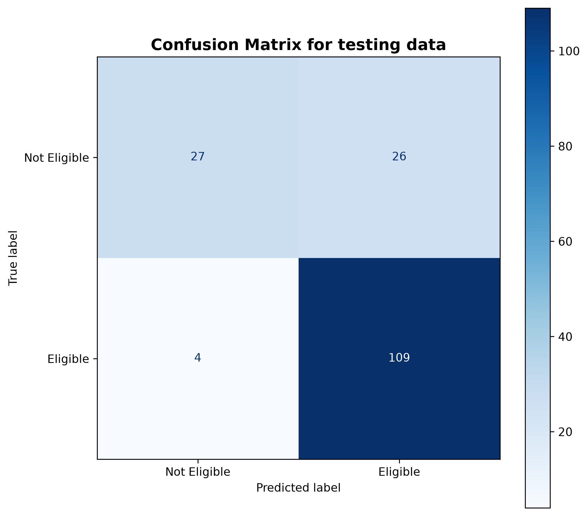

# Loan Eligibility Prediction

A machine learning project that predicts whether a loan application is
likely to be approved or rejected using Logistic Regression and
applicant information.

## Team Members and Roles

| Name | entry number | Role | GitHub Handles |
|---|---|---|---|
| Neil Vikas Patil |2026AIB1062 | Documentation Lead |2026aib1062-creator|
| Devnandan Menon | 2026EEB1343 | Execution Lead | Devnandan-M |
| Tanus Metla | 2026MCB1576 | PPT Lead | 2026mcb1576-hash |
| Abhinav | 2026AIB1002 | Video Lead | AbhinavKaroli|

## Project Structure

``` text
loan-eligibility-prediction-project-grp74/
│
├── main.py                              # Data preprocessing, model training and evaluation
├── Loan_Data.csv                       # Input dataset
├── Loan_Eligibility_Prediction_Group74.pptx  # Project presentation
├── README.md                            # Project documentation
├── requirements.txt                     # Required Python libraries
│
└── Output/                              # Screenshots of program output
```


## Setup

### Install dependencies

``` bash
pip install -r requirements.txt
```

## Steps to Run

Run the following commands in order.

1.  **Clone the repository**

    ``` bash
    git clone https://github.com/2026aib1062-creator/loan-eligibility-prediction-project-grp74.git
    ```

2.  **Move into the project directory**

    ``` bash
    cd loan-eligibility-prediction-project-grp74
    ```


3.  **Run the program**

    ``` bash
    python main.py
    ```

## Expected Output

When the script runs successfully, it trains a Logistic Regression model
and prints its evaluation metrics on the test set and training set.

The terminal output will have this general format:

``` text
Data loaded and cleaned.
Shape of clean dataset: (502, 12)
Logistic Regression model trained successfully!

Made predictions on test data. The following are the performance metrics for the trained logistic regression model.

Precision: 0.807
Recall: 0.965
F1-score: 0.879

Made predictions on training data. The following are the performance metrics for the trained logistic regression model.

Precision: 0.785
Recall: 0.987
F1-score: 0.875

Saved prediction comparison; 'Output/Loan Eligibility prediction comparison.png'
Saved confusion matrix; 'Output/confusion_matrix_for_training_data.png'
Saved confusion matrix; 'Output/confusion_matrix_for_testing_data.png'
```


**The Confusion Matrix of the model on testing data:**



## Project Resources

-   **GitHub repository:** [Loan Eligibility Prediction -- Group
    74](https://github.com/2026aib1062-creator/loan-eligibility-prediction-project-grp74)

-   **Presentation slides:**
-   In the repository

-   **Project video:** 

## AI-Use Disclosure

> AI tools used: ChatGPT
> Purpose: AI was used for graphing the performance metrics,to create organised slide and taken reference for making REAME.md file
